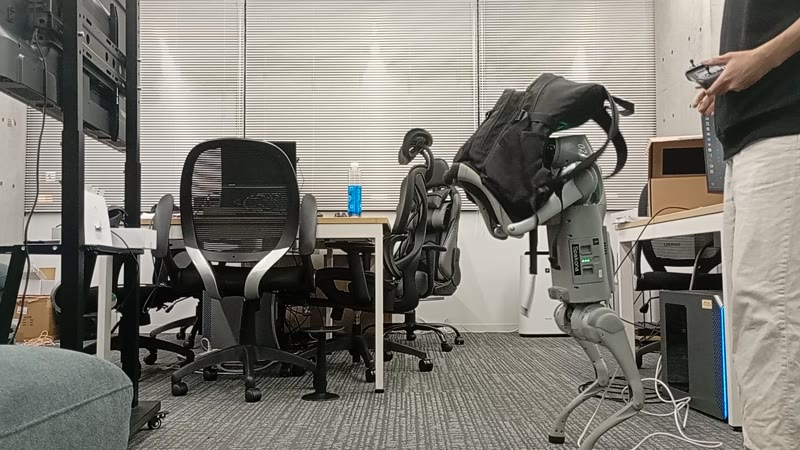

# 後ろ足で立ち、前腕で荷物を受け止めて運ぶ Unitree Go2

Physical AI 応用1講座の最終課題です。

四足ロボット Unitree Go2 が後ろ足だけで立ち、空いた前足を「腕」として使って、人から渡された荷物を前腕で受け止め、持ったままリモコンで指示した方向へ運びます。荷物の重さや形はロボットに知らせません。方策は関節と IMU の履歴だけから、荷物が載ったことを読み取って姿勢を保ちます。荷物がないときは四足に下りて休めます。

- 学習:Isaac Lab で 4096 台を並列に動かし、rsl_rl の PPO で学習します。
- 検証:MuJoCo による sim2sim と、実機と同じ DDS 通信で動く MuJoCo で確かめます。
- 実機:unitree_sdk2 の低レベル制御で、ONNX に書き出した方策を動かします。



## 結果
- シミュレーション、荷物 2 kg:転倒は 0% です。直径 30 / 36 / 44 cm の球を落とす割合は、そっと置いて 0 / 0 / 6%、10 cm の高さから落として 0 / 0 / 6% です。前腕にまたがる箱は 0〜3% です。
- 実機、2026-10-31:後ろ足での立ち上がり 11 回、二足で約 11 分動かしました。水 2 L 入りのカバンという学習していない形の荷物を受け取り、持ったまま旋回・前後・横に移動しました。
- 腕の間隔より小さい物は落とします。挟む持ち方は今後の課題です。

説明資料は [`report/report.html`](report/report.html)、実機の手順は [`deploy/BIPED_TEST.md`](deploy/BIPED_TEST.md) にあります。

## 構成
| 場所 | 内容 |
|---|---|
| `go2_carry/` | Isaac Lab のタスク。環境・報酬・カリキュラム・ドメインランダム化 |
| `go2_carry/refwalk_env_cfg.py` | 後ろ足での二足歩行。参考実装 go2_quad2hand との項目ごとの比較表が冒頭にある |
| `go2_carry/holdv4_env_cfg.py` / `box_mdp.py` | 大きさをランダムにした箱と球を受け取って持つ。箱向きの HoldV4 と、大きい球向きの HoldBall |
| `go2_carry/switch_env_cfg.py` / `switch_mdp.py` | 二足 ↔ 四足の切り替え、実機で測った関節の摩擦・慣性のランダム化 |
| `go2_carry/symmetry.py` | 左右反転のデータ拡張 |
| `go2_carry/tripod_env_cfg.py` | 右前足を上げた三足の、別のタスク |
| `scripts/train.py`, `evaluate.py`, `eval_switch.py`, `export_onnx.py` | 学習・評価・ONNX への書き出し |
| `deploy/go2_real.py` | 実機の制御プログラム。安全装置、二足 ↔ 四足、傾きの補正、撮影用のデモ |
| `deploy/sim2sim_mujoco.py` | MuJoCo での確認 |
| `deploy/sim_dds.py`, `run_sim_test.sh` | 実機と同じ通信で動く MuJoCo と、制御プログラムを通しで試すスクリプト |
| `scripts/make_video.py` | 提出動画の編集 |

## 使い方
実機で測った関節の摩擦・慣性は公開していません。Git の管理外の `real_joints_local.json` がないときは、`deploy/real_joints.py` の例の値を使います。そのため、`--real_joints` や Switch のタスクの結果は、レポートの値と少し変わります。

```bash
# 学習:荷物を持つ二足、切り替えあり
python scripts/train.py --headless --task Unitree-Go2-Biped-HoldBall-Switch --num_envs 4096 --max_iterations 1500
# 評価:2 kg の荷物をそっと置く
python scripts/evaluate.py --task Unitree-Go2-Biped-HoldBall-Switch --checkpoint <model.pt> --start biped --obj_kg 2.0 --cmd 0 0 0
# 書き出しと MuJoCo での確認
python scripts/export_onnx.py <model.pt> --switch
python deploy/sim2sim_mujoco.py <run>/exported --real_joints
```
動作を確認した環境は、Ubuntu 22.04、RTX 3070 Ti 8 GB、Isaac Sim 5.1、Isaac Lab 2.3、unitree_rl_lab、rsl_rl 3.0.1 です。

## 謝辞・参考
- [go2_quad2hand](https://github.com/Sang-SC/go2_quad2hand)、BSD-3 ライセンス:二足歩行の報酬・歩容・ランダム化の設定を参考にしました。前足で立つ逆立ち歩行を、後ろ足で立つ形に読み替えています。
- [unitree_rl_lab](https://github.com/unitreerobotics/unitree_rl_lab):Go2 のモデルと学習の基本設定を使いました。
- W. Yu et al., "Learning Symmetric and Low-Energy Locomotion," SIGGRAPH 2018:補助の力のカリキュラムと左右対称の手法を参考にしました。
- そのほかは [`RELATED_WORK.md`](RELATED_WORK.md) にあります。

## ライセンス
Apache License 2.0 です。`LICENSE` を参照してください。
